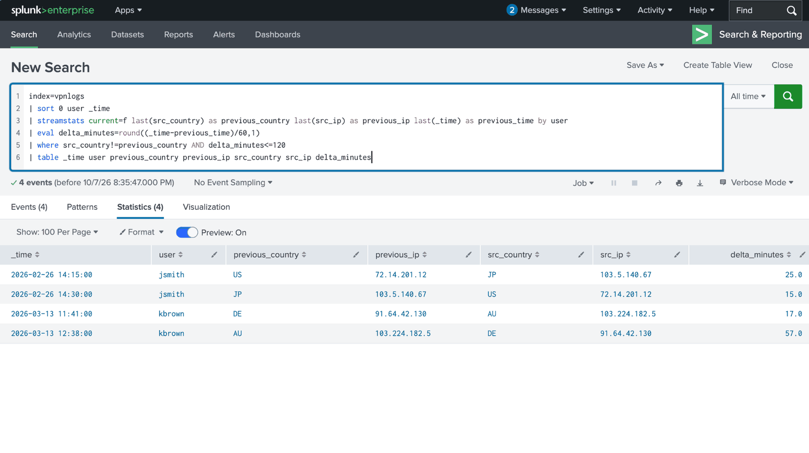

# Xavier Tables | SOC Analyst Portfolio

**CompTIA Security+ (2026) · Seeking SOC Analyst I · Cleveland, Ohio**

I completed Tri-C's SecurePath cybersecurity training. These labs document how I review Windows and VPN activity, test explanations, and support my conclusions with queries and screenshots.

**[Case brief](docs/splunk-incident-brief.md)** · [SOC résumé](resume/Xavier_Tables_SOC_Resume.pdf) · [LinkedIn](https://www.linkedin.com/in/xaviertables/)

## Featured case: Windows and VPN activity in Splunk

I found **two rare-country VPN events** involving users whose other recorded logins came from a different country. Four transitions around those events were **15–57 minutes apart**. The pattern warranted further identity checks; the available fields did not establish account compromise.

I compared each user's country and source-IP history, then used SPL to calculate the gaps between logins. The supplied TryHackMe datasets contained 2,000 VPN events and 12,256 Windows events; my query log records 11 executed searches across both.

**Status:** Further investigation recommended. Device, MFA, and routing context remain unresolved. The separate Windows lead identified account activity and Sysmon ancestry; host/session validation remains open.

**[Read the case brief](docs/splunk-incident-brief.md)** · [Full investigation](projects/splunk-siem-investigation/README.md) · [Executed SPL](projects/splunk-siem-investigation/queries/investigation-queries.md) · [Sample handoff](docs/splunk-retrospective-triage-ticket.md)

## Lab projects

| Project | Work demonstrated | Recorded outcome |
| --- | --- | --- |
| **[Splunk investigation](projects/splunk-siem-investigation/README.md)** | SPL searches, Windows account-event review, Sysmon ancestry, VPN baselining | Two independent leads documented for follow-up |
| **[Windows Security Log Triage](projects/windows-security-log-triage/README.md)** | Compared four Event Viewer records and their account/process context | Distinguished an Administrator password change from later SYSTEM service activity |
| **[Nessus Baseline Scan](projects/nessus-vulnerability-assessment/README.md)** | Configured and completed a guided authenticated scan of one lab host | Recorded severity totals; individual finding validation remains open |

Each report opens with the question, work performed, finding, status, and evidence links.

## Evidence preview

*Open the screenshot for the original query and results, or review the [full evidence index](projects/splunk-siem-investigation/README.md#evidence).*

## Tools and background

**Documented here:** Splunk/SPL, Windows Event Viewer, Security logs, Sysmon, and Nessus.

**Additional training:** Windows/Linux, Active Directory fundamentals, Wireshark, Nmap, TCP/IP, DNS, and DHCP.

**Education:** Tri-C SecurePath cybersecurity training, completed June 2026; Associate of Arts, Cuyahoga Community College (2022).

## More work

[IT Support and troubleshooting](it-support/README.md) · [Security research](research/README.md)
