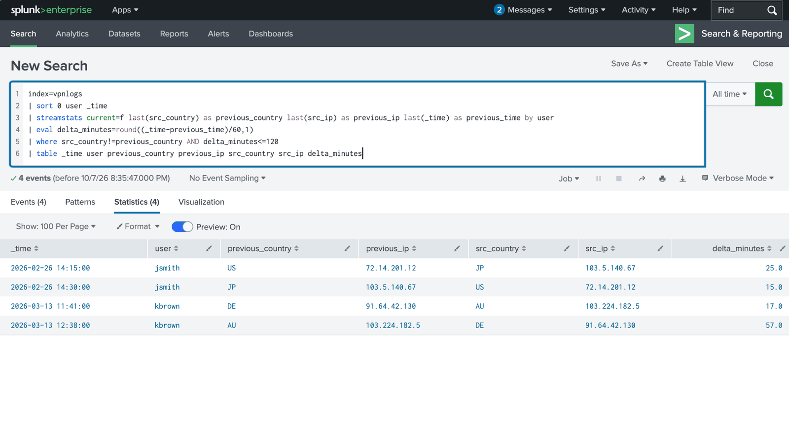

# Xavier Tables | SOC Analyst I Portfolio

**CompTIA Security+ (SY0-701, 2026)** · [**Verify credential**](https://cp.certmetrics.com/comptia/en/public/verify/credential/6db4d2287b874b0691ab56167cc0d7ff) · **Tri-C SecurePath graduate** · **Cleveland, Ohio**  
**Career focus: SOC Analyst I / Tier 1 Security Operations**  
*Splunk investigations · Windows security logs · Alert triage · Evidence-based decisions*

I'm working toward my first SOC Analyst role. I use this portfolio to show **how I work through an investigation**, not just which tools I've studied: what stood out, how I checked it, and what I could support with the evidence. These are labs and training investigations, not production SOC incidents.

[**SOC résumé**](resume/Xavier_Tables_SOC_Resume.pdf) · [**LinkedIn**](https://www.linkedin.com/in/xaviertables/) · [**Featured investigation**](projects/splunk-siem-investigation/README.md)

---

## Projects at a glance

| Investigation | What I worked on | What the evidence showed |
| --- | --- | --- |
| **[Splunk: VPN and Windows activity](projects/splunk-siem-investigation/README.md)** | SPL searches, VPN baselines, Windows Security events and Sysmon process relationships | Two unusual VPN country events and four rapid transitions; **account compromise not established**. The separate Windows lead needs stronger host/session correlation. |
| **[Windows Security Log Triage](projects/windows-security-log-triage/README.md)** | Event Viewer, account changes, Logon IDs and privileged activity | Records supported an Administrator password change; later **SYSTEM service activity was a separate event group**. |
| **[Nessus Baseline Scan](projects/nessus-vulnerability-assessment/README.md)** | Authenticated vulnerability scan of one Windows lab host | Scan completed and reported severity totals; **individual vulnerabilities still need validation**. |

These are training and lab investigations. The write-ups link to the evidence I retained and distinguish findings from follow-up work.

## Featured case: unusual VPN logins in Splunk

**What caught my attention:** Two users had logins labelled with countries that were rare compared with their usual activity. Each account had **one outlier among 200 events**.

**What I checked:** I compared each user's country and source-IP history, then used SPL to measure time gaps. Four transitions around the outliers occurred **15–57 minutes apart**.

**My decision:** That was enough to justify investigating, but not enough to say someone stole an account. I would need device and MFA records, source-IP context, and account-owner confirmation before making that call.

I also reviewed a **separate Windows account-activity lead** in the same project. The retained Security and Sysmon views did not establish a common computer/session, so I kept that conclusion open rather than forcing a connection.

[**Read the investigation**](projects/splunk-siem-investigation/README.md) · [Case brief](docs/splunk-incident-brief.md) · [Executed SPL](projects/splunk-siem-investigation/queries/investigation-queries.md) · [Sample SOC handoff](docs/splunk-retrospective-triage-ticket.md)

*The original search and results are in the screenshot. The [full report](projects/splunk-siem-investigation/README.md) explains the query choices and what the data cannot prove.*

## How I approach an investigation

I'm learning that an unusual event and a confirmed incident are not the same thing. I start by narrowing down what stands out, checking the surrounding context, and writing down what I can actually support. If something doesn't line up—like a Windows Logon ID without the right host or time context—I would rather identify the missing check than make a claim I can't defend.

## Tools and training

- **Documented here:** Splunk / SPL, Windows Event Viewer, Security logs, Sysmon and Nessus.
- **Additional coursework:** Windows/Linux, Active Directory fundamentals, Wireshark, Nmap, TCP/IP, DNS and DHCP.
- **Training:** Tri-C SecurePath Cybersecurity Program, completed June 2026; CompTIA Security+ certified in 2026.
- **Education:** Associate of Arts, Cuyahoga Community College, December 2016.

**More lab work:** [Nmap service discovery](labs/nmap-service-discovery/README.md) · [SSH and VNC authentication](labs/remote-access-security/README.md) · [SMTP enumeration](labs/smtp-enumeration/README.md)

**Additional work:** [Security research](research/README.md) · [Windows and IT troubleshooting fundamentals](it-support/README.md)
