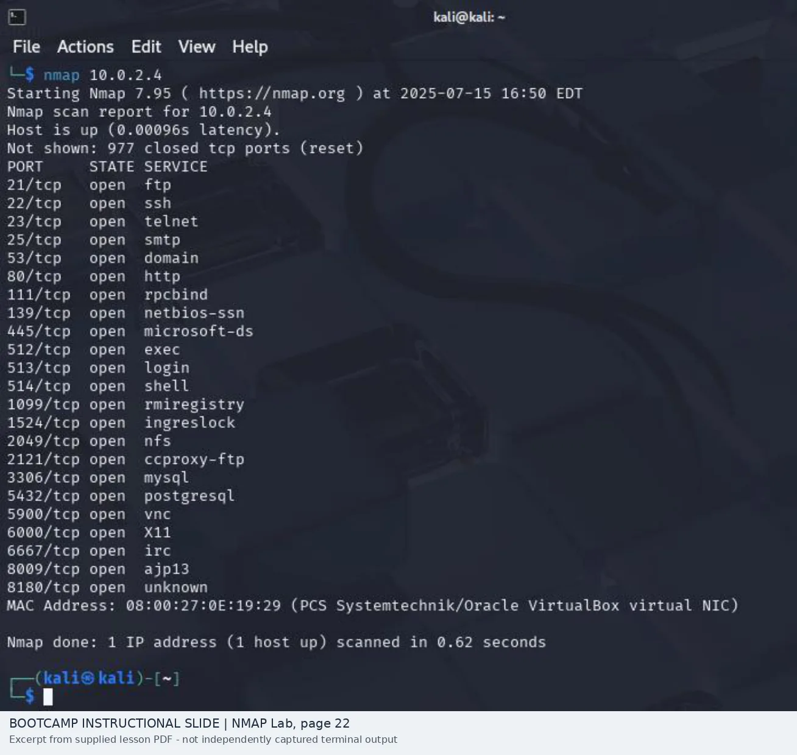
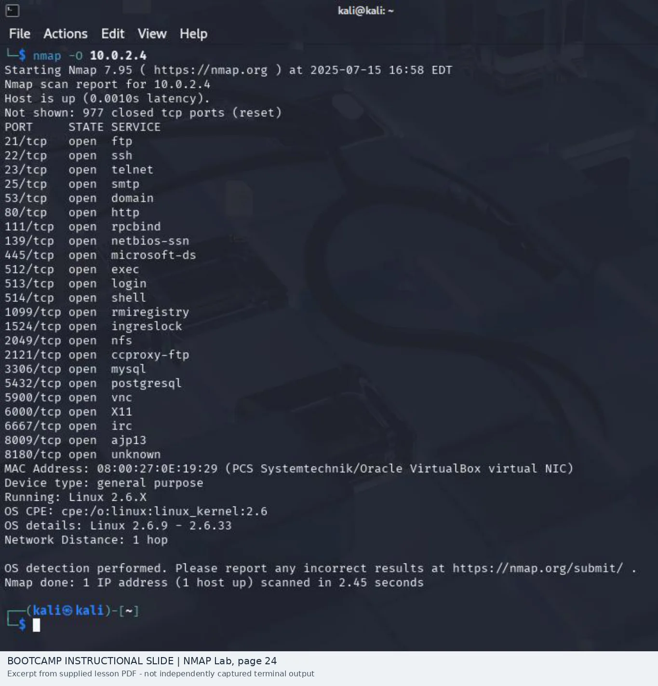
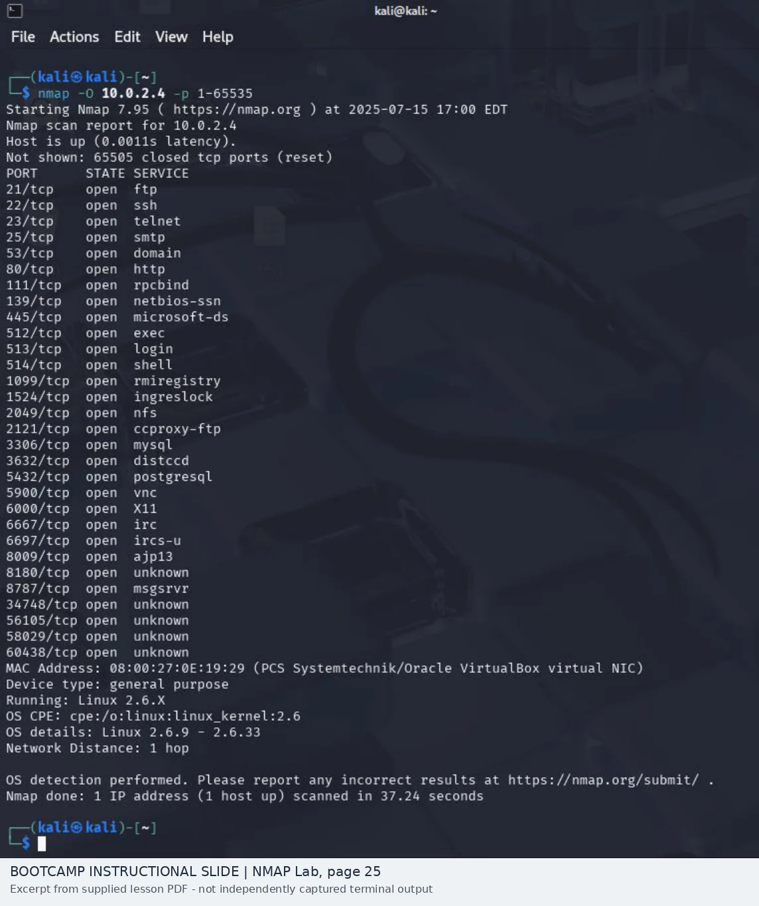

# Nmap Service Discovery | Default Scan vs. All Ports

**Completed CySA+ guided-lab review** · Tri-C SecurePath · Kali Linux / Metasploitable 2  
[Portfolio](../../README.md) · [Lab collection](../README.md) · [Reproduce and capture your own results](../reproduce-and-capture.md)

## The question

What could I miss if I only scan Nmap's default TCP port set?

The answer in this guided exercise was **seven open TCP ports**. The provided default scan reported **23**, while the all-port scan reported **30**.

| Scan | Example command | Open TCP ports shown |
| --- | --- | ---: |
| Default TCP scan | `nmap 10.0.2.4` | 23 |
| OS-detection scan | `nmap -O 10.0.2.4` | OS fingerprint information |
| All TCP ports + OS detection | `nmap -O -p 1-65535 10.0.2.4` | 30 |

The images below are **course reference screenshots**, not independently saved scan output. Their Nmap timestamps are from July 15, 2025; this report is my analysis of those recorded examples. [Image sources and slide numbers](evidence/README.md).

## 1. The first scan: where I'd begin

*Exercise 5, p.22 — default scan: 23 open TCP ports.*

The results show services associated with SSH (22), Telnet (23), SMTP (25), HTTP (80), SMB (139/445), MySQL (3306), PostgreSQL (5432), and VNC (5900), among others.

My first thought wouldn't be "23 vulnerabilities." I'd ask why this VM has so many listeners, whether they are expected, and which should be reachable from the scanning segment.

## 2. OS fingerprint: a useful estimate

*Exercise 5, p.24 — Nmap reports a Linux 2.6.x fingerprint.*

The example suggests a Linux 2.6.x kernel family and a VirtualBox-related network interface. The kernel range is an **estimate based on network responses**; host inventory or direct system access would be needed to validate the exact platform.

## 3. The full-range scan: what changed

*Exercise 5, p.25 — full TCP scan reports 30 open ports.*

Seven ports were visible in the full-range screenshot that didn't appear in the default result:

| Additional port | Label in the displayed output | My next check |
| --- | --- | --- |
| 3632/tcp | `distccd` | Confirm the actual service/version and whether it should be exposed |
| 6697/tcp | `ircs-u` | Verify the service, ownership, and network access need |
| 8787/tcp | `msgsrvr` | Validate the listener instead of assuming a product from the port label |
| 34748/tcp | `unknown` | Inspect the responding application and host process |
| 56105/tcp | `unknown` | Inspect the responding application and host process |
| 58029/tcp | `unknown` | Inspect the responding application and host process |
| 60438/tcp | `unknown` | Inspect the responding application and host process |

**Why that matters:** Nmap's initial service label can come from a port-number association. I wouldn't call any of these a confirmed vulnerable application until I checked with service-version detection, inventory, or host process data.

## My analyst assessment

**Observation:** The all-port scan reveals a wider attack surface than the default scan.

**Risk to investigate:** Unneeded remote-access, file-sharing, legacy, and database services can expose additional authentication interfaces or software requiring patch and configuration review.

**Decision:** Prioritize unexpected listeners and verify each relevant service. Open ports are **leads**, not vulnerability confirmations, so I would not assign a CVSS score here.

**How I'd hand this off:** "One authorized lab host presented 30 open TCP ports in the full scan versus 23 in the default scan. Validate ownership and reachability of the seven additional listeners; follow up with version detection and configuration checks before assigning risk."

## Practical next steps

- Confirm the asset, authorized scan scope, and expected service inventory.
- Perform targeted `-sV` verification on ports worth investigating.
- Compare the observed surface with the Nessus results and platform configuration.
- Restrict or disable unnecessary services, then re-scan after approved changes.
- Preserve original Nmap normal/XML output when performing the lab yourself.

This connects directly to my [Nessus assessment](../../projects/nessus-vulnerability-assessment/README.md): first establish **what is listening**, then validate **what is vulnerable**.

## Evidence and recreation

- [Three cropped course screenshots with source pages](evidence/README.md)
- [Independent Nmap scan and screenshot instructions](../reproduce-and-capture.md)

**Status:** Guided-training analysis complete. An independently captured re-run would be stronger evidence, but is not presented here as already performed.

## References

- [Nmap Reference Guide](https://nmap.org/book/man.html)
- [Service and Version Detection](https://nmap.org/book/man-version-detection.html)
- [Port Scanning Techniques](https://nmap.org/book/man-port-scanning-techniques.html)
