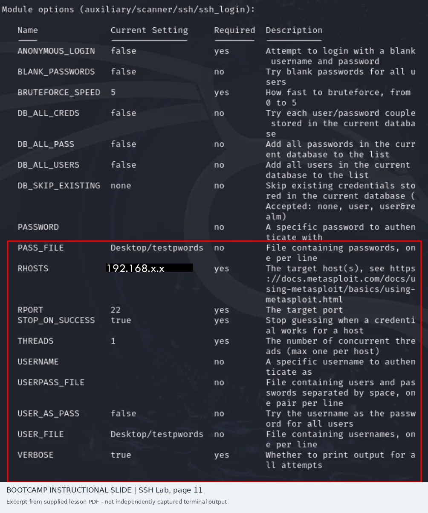
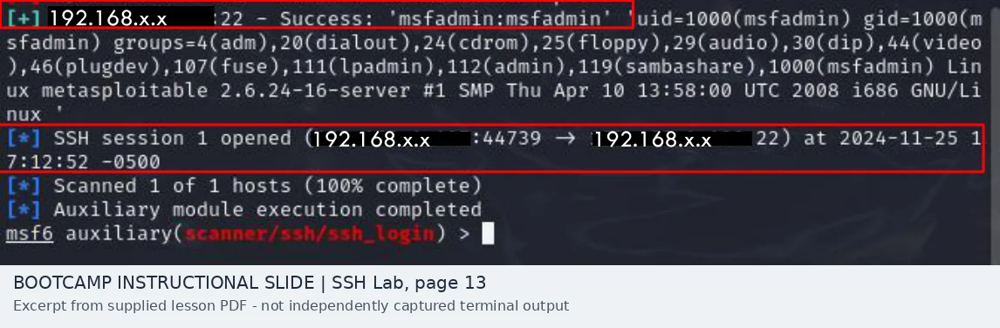
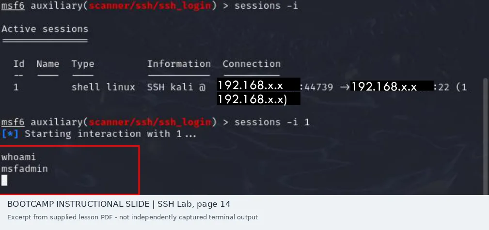

# SSH: Weak Credential Authentication and Shell Verification

[Combined report](README.md) · [VNC comparison](vnc-analysis.md) · [Evidence index](evidence/README.md)

## Question

In the guided SSH exercise, did a successful username/password guess actually provide a remote shell? What level of access is visible?

## Steps shown in the training material

The instructor example starts the Metasploitable and Kali VMs and opens `msfconsole`. The module is `auxiliary/scanner/ssh/ssh_login`, configured with a small exercise wordlist for both usernames and passwords. It sets `RHOSTS`, enables verbose output, uses `STOP_ON_SUCCESS`, and executes the login scanner against TCP 22.



*Source: SecurePath Lab Exercise 2, page 11; screenshot taken from the instructional PDF.*

## What the example returned

The console excerpt on page 13 reports:

```text
Success: 'msfadmin:msfadmin'
SSH session 1 opened
Scanned 1 of 1 hosts (100% complete)
Auxiliary module execution completed
```



A second excerpt on page 14 lists shell session 1, selects it with `sessions -i 1`, and returns:

```text
whoami
msfadmin
```



The combination of login success, an opened session, and `whoami` gives more support than the scanner's success message by itself. **The authenticated account was `msfadmin`, not `root`.**

## What I conclude

This example shows a password-based login succeeding against the purposely insecure Metasploitable target. It does **not** show an exploit against the SSH implementation, a privilege escalation, persistence, credential theft, or lateral movement.

The slide uses known training credentials. A successful trial against that vulnerable VM illustrates the risk of default passwords, but does not tell me how likely the attack would be against a hardened organization's SSH server.

## How I would follow up on a real assessment

I would first confirm the host and SSH service were in scope, obtain its access policy and ownership, and identify whether password authentication and the demonstrated account were intended. I would review SSH server authentication logs for the attempts and successful login, consider the source system and timing, and verify whether the account should have interactive access.

**Remediation:** Replace default credentials, disable unused accounts, restrict remote SSH access, consider managed keys and MFA where supported, and review login alerting. A re-test should confirm the old credentials fail without disrupting authorized administrators.

## Evidence limitation

These images are **cropped instructor-provided slide examples**. They are preserved so the analysis is checkable, but are not presented as my independently produced terminal captures. The session screenshot shows a historical date that should not be misrepresented as the date I ran a lab.
