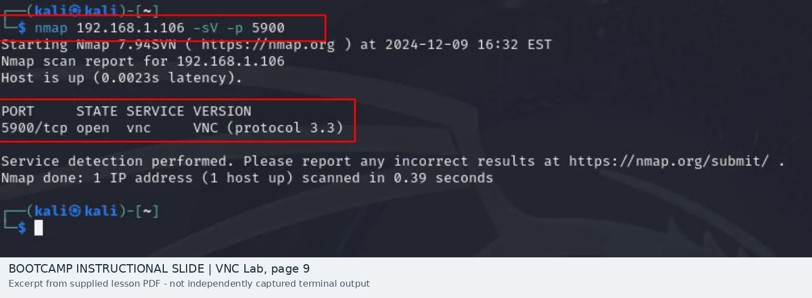
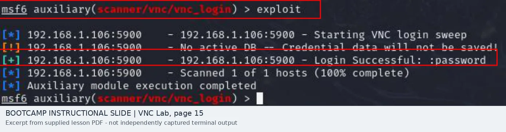

# VNC: Port 5900 Discovery and Weak Password Check

[Combined report](README.md) · [SSH comparison](ssh-analysis.md) · [Evidence index](evidence/README.md)

## Question

Could the demonstrated VNC service be discovered and authenticate with a weak password? Does the evidence show full remote desktop access?

## Discovery shown in the lesson

The guided material uses Nmap against the deliberately vulnerable Metasploitable VM:

\`\`\`text
nmap 192.168.1.106 -sV -p 5900
5900/tcp open vnc VNC (protocol 3.3)
\`\`\`

*Source: SecurePath Lab Exercise 3, page 9; instructor-slide screenshot.*

An open port indicates a reachable service responding to Nmap. It is **not** proof the host was available from the internet.

## Authentication result shown

The exercise uses Metasploit's \`auxiliary/scanner/vnc/vnc_login\` against the lab IP. The instruction slide describes trying the module's password list. The terminal excerpt reports:

\`\`\`text
192.168.1.106:5900 - Starting VNC login sweep
192.168.1.106:5900 - Login Successful: :password
Scanned 1 of 1 hosts (100% complete)
Auxiliary module execution completed
\`\`\`

*Source: Lab Exercise 3, page 15; instructor-slide screenshot.*

## What I conclude

The example demonstrates a **weak VNC password accepted by an authentication scanner** in the lab. It does not include a screen capture of an active VNC viewer controlling the desktop, so I would not claim confirmed graphical access.

The original lesson title says "VPN Port 5900." That is a terminology mistake: TCP 5900 in this exercise is **VNC**, a remote graphical-desktop protocol, not a VPN.

## Defensive significance and next checks

If a production VNC endpoint accepts a predictable password, an unauthorized party who can reach the service may be able to access a graphical session. The actual impact depends on the application's security, network reachability and session rights.

I would review the network rules, product/version, server-side authentication configuration, VNC session restrictions and logs. I would require a unique strong password or approved identity integration, limit management access, verify encryption/secure transport, and test that weak credentials are rejected. Server-side records and a permitted test session would be needed to confirm the full access path.

## Evidence limitation

The slide contains an example of a successful password check, not an independently captured user test result, production exposure proof, or verified desktop session.
