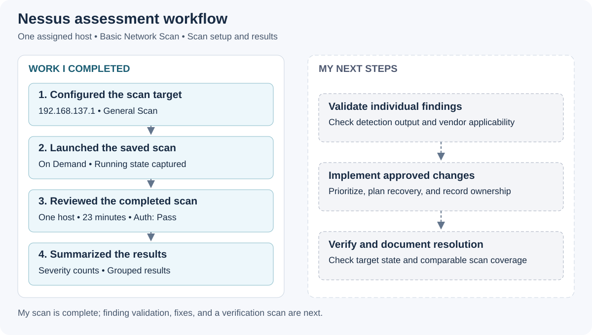

# Nessus Vulnerability Assessment: Guided Baseline Scan

**Case:** LAB-NES-002 · **Environment:** uCertify training lab · **Tool:** Nessus Professional

## Summary

I configured and ran a guided **Basic Network Scan** against one assigned host. The scan completed in **23 minutes**, displayed **Auth: Pass**, and reported **60 Critical** and **98 High** results.

This project covers scan setup, completion, and interpretation of the summary/grouped results. Individual finding validation, applied fixes, and a verification rescan remain open.


## Scope and method

The provider supplied the scanner, target, and Windows credentials. I accessed the scanner at `https://localhost:8834`, selected Basic Network Scan, named it **General Scan**, targeted `192.168.137.1`, configured the supplied Windows credentials, and launched it **On Demand**.

The scanner login and target credentials served different purposes: one accessed the interface; the other enabled checks on the assigned host. I followed the running scan through completion and reviewed the host summary and Vulnerabilities view.

## Results

| Recorded field | Value |
|---|---|
| Assessed hosts | 1 |
| Status | Completed |
| Authentication indicator | Pass |
| Displayed start/end | Today at 2:30 AM / Today at 2:53 AM |
| Elapsed time | 23 minutes |
| Severity basis | CVSS v3.0 |

The relative **Today** labels do not establish an absolute scan date or time zone. Auth: Pass records the scanner's authentication result; it does not by itself establish that every intended credentialed check had complete coverage. [Tenable describes the additional requirements for credentialed checks](https://docs.tenable.com/nessus/10_12/Content/NessusCredentialedChecks.htm).

| Severity category | Readable host-summary count |
|---|---|
| Critical | 60 |
| High | 98 |
| Medium | 65 |
| Low | Not reliably readable |
| Informational | 239 |

These are **scanner-reported result counts**. The severity summary does not identify which findings truly apply, establish exploitability, or provide a complete risk ranking. That would require individual detection evidence and asset/exposure context.

## Grouped results

The [Vulnerabilities view](evidence/05-grouped-results.png) showed a **69** badge, grouped rows with **MIXED** severities, and Windows-related plugin families. The **Remediations** tab showed **21**.

Tenable groups related plugins into rows and can display MIXED when their severities differ. The 69 badge was not validated as a unique-CVE total. The 21 badge was not evidence of applied changes. A group/family name alone was insufficient to select a patch.

## Conclusion and follow-up

**Assessment:** Guided baseline scan complete. The reported results need finding-level review before choosing and verifying fixes.

| Next step | Evidence needed |
|---|---|
| Validate an individual finding | Plugin title/ID, detection output, affected component/version, and vendor applicability guidance |
| Prioritize applicable exposure | Reachability, asset importance, severity, and relevant exploitation context |
| Plan an approved change | Supported fix, responsible owner, dependencies, maintenance and recovery plan |
| Verify the change | Target-state check and a comparable rescan with adequate authentication/check coverage |

I have not completed these follow-up steps. When I rescan, I will compare coverage as well as result counts.

## Evidence and integrity



| Artifact | What it records |
|---|---|
| [01: Template selection](evidence/01-scan-template.png) | Basic Network Scan available in the lab |
| [02: Configuration](evidence/02-scan-configuration.png) | Scan name and assigned target |
| [03: Running scan](evidence/03-scan-running.png) | Execution in progress |
| [04: Completed scan](evidence/04-completed-scan.png) | One host, authentication indicator, runtime, and severity counts |
| [05: Grouped results](evidence/05-grouped-results.png) | Group labels, severity presentation, and tab badges |

I saved screenshots of the scan setup and results. I did not save a native scan export or individual plugin details.

[SHA256SUMS](SHA256SUMS) covers the five screenshots and workflow SVG. To verify the files from the downloaded project directory on macOS:

```bash
shasum -a 256 -c SHA256SUMS
```

## What I learned

Finishing the scan gave me a baseline, but I still needed plugin details to judge applicability and select a fix. Authentication and complete check coverage also needed separate attention. My next useful improvement would be to document one finding through validation and verification.

## References

- [Tenable: Manage Vulnerabilities](https://docs.tenable.com/nessus/Content/manage-vulnerabilities.htm)
- [Tenable: Credentialed Checks](https://docs.tenable.com/nessus/10_12/Content/NessusCredentialedChecks.htm)
- [FIRST: CVSS severity and risk guidance](https://www.first.org/cvss/v3.1/user-guide) (the captured scan displayed CVSS v3.0)
