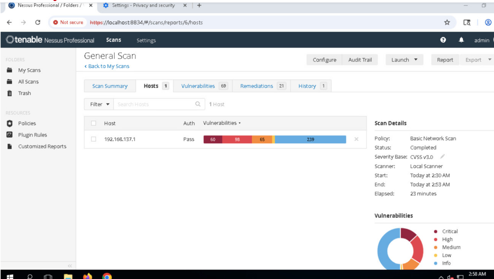

# Nessus Baseline Scan

**Case:** LAB-NES-002 · **Environment:** uCertify training lab · **Tool:** Nessus Professional
**Status:** Guided scan completed; plugin-level validation and remediation remain follow-up work

[Portfolio](../../README.md) · [Evidence index](#scope-and-evidence)

## What I did

I configured and ran a Basic Network Scan against one assigned Windows lab host, using the supplied host credentials. The scan completed in **23 minutes** and displayed **Auth: Pass**.

*Open the image for the original scan summary.*

## Recorded results

| Evidence | Observation | Interpretation |
| --- | --- | --- |
| [Completed scan](evidence/04-completed-scan.png) | One host; Completed; 23 minutes; Auth: Pass | The scanner reported successful authentication. This indicator alone does not establish coverage of every credentialed check. |
| [Severity summary](evidence/04-completed-scan.png) | 60 Critical, 98 High, 65 Medium, 239 Informational; Low count not reliably readable | Scanner-reported result counts, pending validation of individual findings |
| [Grouped results](evidence/05-grouped-results.png) | 69 badge on Vulnerabilities; 21 on Remediations; MIXED severity groups | The saved screen does not establish what those badges count |

The interface displayed CVSS v3.0 categories and Today, 2:30–2:53 AM. The exact scan date and time zone cannot be established from those screenshots.

## Assessment and next step

I would start by opening one Critical or High finding and recording its plugin ID, detection evidence, affected software/version, and applicable vendor guidance. Asset importance and reachability would help determine its priority.

After an approved change, I would verify the configuration and run a comparable authenticated rescan. Individual plugin output, remediation, and rescan results were not captured in this exercise.

## Scope and evidence

The provider supplied the scanner, target **192.168.137.1**, and Windows credentials. Scanner-interface credentials and host-check credentials served different purposes.

- [01: Scan templates](evidence/01-scan-template.png)
- [02: Target and configuration](evidence/02-scan-configuration.png)
- [03: Scan running](evidence/03-scan-running.png)
- [04: Completed scan and severity summary](evidence/04-completed-scan.png)
- [05: Grouped results](evidence/05-grouped-results.png)

[SHA256 checksums](SHA256SUMS) cover the screenshots and [workflow diagram](images/assessment-workflow.svg). The retained evidence consists of images; a native scan export is unavailable.

## What I learned

Completing a scan gave me a list of leads. Selecting a fix requires the plugin's evidence and the affected system's context, followed by a check that the change worked.

## References

- [Tenable: Credentialed checks](https://docs.tenable.com/nessus/10_12/Content/NessusCredentialedChecks.htm)
- [Tenable: Manage vulnerabilities](https://docs.tenable.com/nessus/Content/manage-vulnerabilities.htm)
- [FIRST: CVSS guidance](https://www.first.org/cvss/v3.1/user-guide)
